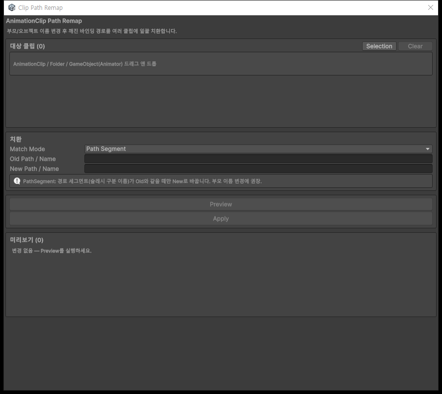
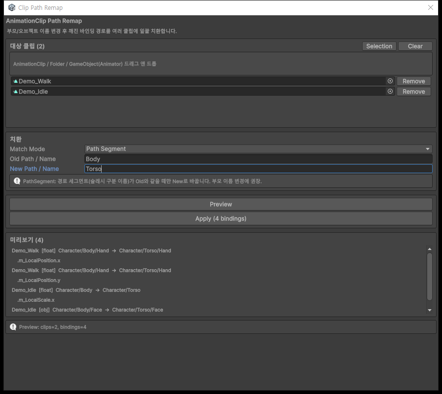

# AnimationClip Path Remap 사용 가이드

## 개요

Transform 이름 변경이나 부모 구조 변경으로 맞지 않게 된 **AnimationClip 바인딩 경로**를 일괄 치환합니다. 기존 커브를 읽고 path만 바꾼 바인딩에 다시 연결합니다.

설치부터 기본 사용까지는 [README](../README.md)를 참고하세요. 이 문서는 구체적인 사용 시나리오와 Editor API를 설명합니다.

---

## 접근 방법

- 사용자 메뉴: **Tools → Animation → Clip Path Remap**
- 스크립트 / Agent: `AnimationClipPathRemapEditorWindow.Open();`
- 변경 없이 조회: `AnimationClipPathRemapper.Preview(...)`
- 적용: `AnimationClipPathRemapper.Remap(...)`

모든 API는 Unity Editor에서만 사용할 수 있습니다. 프로젝트 코드에서 호출한다면 Editor 폴더 또는 Editor 전용 어셈블리에 둡니다.

---

## UI 미리보기





*Unity 6000.6.0f1에서 캡처했습니다. `Demo_Walk`와 `Demo_Idle`은 문서용 메모리 샘플입니다. 캡처는 Preview 단계이며 프로젝트의 게임 클립을 적용·수정하지 않았습니다.*

---

## UI 구성

| 영역 | 동작 |
|---|---|
| **대상 클립** | 드롭 또는 **Selection**으로 추가합니다. 중복은 제거합니다. **Remove**는 하나만, **Clear**는 전체를 목록에서 제외합니다. |
| **치환** | **Match Mode**, **Old Path / Name**, **New Path / Name**을 설정합니다. 입력값 변경 후에는 Preview를 다시 실행합니다. |
| **Preview** | 현재 조건의 변경 예정 목록을 계산합니다. 원본은 수정하지 않습니다. |
| **Apply (N bindings)** | 변경이 있는 Preview 이후 활성화됩니다. 확인 창의 **Apply**로 적용하고 **Cancel**로 취소합니다. |
| **미리보기** | 클립명, 커브 종류, 이전 → 새 path, 프로퍼티를 표시합니다. 스크롤해 전체 목록을 확인합니다. |
| **하단 상태** | `Preview: clips=N, bindings=M` 또는 `Applied: dirtyClips=N, bindings=M`을 표시합니다. |

### 대상 수집의 범위

- **클립:** 지정한 AnimationClip을 추가합니다.
- **폴더:** 하위까지 `t:AnimationClip`으로 검색하고 에셋 경로마다 클립 하나를 로드합니다. FBX의 여러 하위 클립을 모두 열거하지는 않습니다.
- **GameObject:** 해당 오브젝트 자체의 Animator에 연결된 Controller의 `animationClips`를 읽습니다. 자식 Animator를 찾지 않습니다.
- **Selection:** 위 세 입력 방식과 같은 기준으로 현재 선택에서 추가합니다. 기존 대상 목록은 유지합니다.
- **직접 입력 불가:** Animator Controller 에셋과 Legacy Animation 컴포넌트의 클립을 자동 수집하는 기능은 없습니다.

대상 목록을 추가·제거하면 미리보기를 비웁니다. 반면 치환 입력값을 바꿔도 기존 미리보기는 남으므로 직접 다시 Preview해야 합니다.

---

## 주요 기능

| 모드 | 일치 기준 | 주의점 |
|---|---|---|
| **Path Segment** / `PathSegment` | `/`로 구분된 이름과 Old가 정확히 같음 | Old는 `/` 없는 단일 이름입니다. 한 경로 안의 모든 일치 세그먼트가 바뀝니다. |
| **Path Prefix** / `PathPrefix` | path가 Old와 같거나 `Old/`로 시작 | 이름 경계를 지킵니다. New를 비우면 접두와 구분 슬래시를 제거합니다. |
| **Exact Path** / `ExactPath` | 전체 path가 Old와 같음 | 하위 경로까지 바꾸지 않습니다. 같은 path의 여러 프로퍼티는 모두 대상입니다. |
| **Substring** / `Substring` | 문자열 안에 Old가 포함됨 | 이름 일부도 바꿉니다. `Bodyguard`에서 `Body`를 바꾸면 `Torsoguard`가 됩니다. |

모든 모드는 대소문자를 구분합니다. 숫자 커브와 오브젝트 참조 커브에 동일한 경로 규칙을 사용합니다.

---

## 사용 시나리오

### 1. 부모 이름 변경: Body → Torso

하이어라키에서 이름을 먼저 바꾼 상황입니다.

```text
이전 바인딩: Character/Body/Hand
현재 구조:  Character/Torso/Hand
```

1. 관련 Walk / Idle 등의 클립 또는 폴더를 추가합니다.
2. **Match Mode = Path Segment**, **Old = Body**, **New = Torso**를 입력합니다.
3. **Preview**에서 `Character/Torso/Hand`처럼 의도한 이름만 바뀌는지 확인합니다.
4. **Apply** 후 실제 Animator로 재생합니다.

X·Y 위치 커브 두 개와 Scale 커브 하나, Sprite 참조 커브 하나라면 **4 bindings**로 표시됩니다. 이는 오브젝트 4개나 키프레임 4개라는 뜻이 아닙니다.

### 2. 상위 구조 변경: Character/Body → Rig/Torso

```text
Character/Body        → Rig/Torso
Character/Body/Hand   → Rig/Torso/Hand
Character/Body/Face   → Rig/Torso/Face
Character/Bodyguard   → 변경 없음
```

1. **Match Mode = Path Prefix**를 선택합니다.
2. **Old = Character/Body**, **New = Rig/Torso**를 입력합니다.
3. **Preview**에서 부모 자체와 자식 경로들이 함께 바뀌는지 확인한 뒤 적용합니다.

불필요한 상위 경로를 없앨 때도 PathPrefix를 사용합니다. **Old = Character/Body**, **New = 빈 값**이면 `Character/Body/Hand`가 `Hand`로 바뀝니다. Old 자체의 path는 빈 경로, 즉 재생 루트가 됩니다.

### 3. 한 오브젝트 경로만 변경

```text
Character/Body/Hand        → Character/Accessories/Hand
Character/Body/Hand/Finger → 변경 없음
```

1. **Match Mode = Exact Path**를 선택합니다.
2. **Old = Character/Body/Hand**, **New = Character/Accessories/Hand**를 입력합니다.
3. **Preview**로 하위 Finger 경로가 제외되는지 확인하고 적용합니다.

ExactPath도 해당 경로의 모든 프로퍼티를 바꿉니다. 특정 프로퍼티만 선택하거나 미리보기의 일부 행만 체크하는 기능은 없습니다.

---

## Editor API

### 경로 하나 확인

```csharp
bool changed = AnimationClipPathRemapper.TryRemapPath(
    "Character/Body/Hand",
    "Body",
    "Torso",
    AnimationClipPathRemapper.MatchMode.PathSegment,
    out string newPath);
// changed == true, newPath == "Character/Torso/Hand"
```

매칭하더라도 최종 경로가 같으면 `false`를 반환합니다. 빈 Old는 변경하지 않으므로, 루트 바인딩을 바꾸려고 Old를 빈 값으로 두는 방식은 지원하지 않습니다.

### 폴더 수집 + Preview

```csharp
var clips = AnimationClipPathRemapper.FindClipsUnderFolder(
    "Assets/Animations/Character");

var result = AnimationClipPathRemapper.Preview(
    clips,
    "Body",
    "Torso",
    AnimationClipPathRemapper.MatchMode.PathSegment);

Debug.Log($"대상 클립={result.ClipCount}, 변경 바인딩={result.BindingChangeCount}");
foreach (var change in result.Changes)
{
    string kind = change.IsObjectReference ? "obj" : "float";
    Debug.Log($"{change.Clip.name} [{kind}] {change.OldPath} -> {change.NewPath} .{change.PropertyName}");
}
```

`FindClipsUnderFolder`는 Unity 에셋 경로를 받습니다. 없거나 유효하지 않은 폴더라면 빈 목록을 반환합니다. OS 절대 경로를 넣지 않습니다.

### 적용 없이 Remap 호출 확인

```csharp
var dryRun = AnimationClipPathRemapper.Remap(
    clips, "Body", "Torso",
    AnimationClipPathRemapper.MatchMode.PathSegment,
    dryRun: true);
```

`dryRun: true`는 커브 수정·Undo 기록·저장을 하지 않습니다. Preview처럼 중복을 제거한 대상 클립 수와 변경 예정 목록을 반환합니다.

### 실제 적용

아래는 **즉시 원본을 수정하는 별도 호출**입니다. Preview를 검토하고 적용을 결정한 뒤 실행합니다.

```csharp
var applied = AnimationClipPathRemapper.Remap(
    clips, "Body", "Torso",
    AnimationClipPathRemapper.MatchMode.PathSegment,
    dryRun: false);

Debug.Log($"수정 클립={applied.ClipCount}, 변경 바인딩={applied.BindingChangeCount}");
```

- `dryRun`의 기본값은 **false**입니다. 조회 목적이면 명시적으로 true를 넣거나 Preview를 사용합니다.
- API에는 UI의 확인 대화상자가 없습니다.
- `Preview` / `Remap`은 중복 클립과 null을 제외합니다.
- `CollectChanges(...)`는 전달된 목록을 그대로 순회하므로 직접 호출할 때는 중복 클립을 먼저 제거합니다.

---

## 내부 동작 원리

1. `GetCurveBindings`와 `GetObjectReferenceCurveBindings`로 커브 바인딩을 모읍니다.
2. 각 binding의 path를 `TryRemapPath`로 계산합니다.
3. Preview는 변경 목록만 반환합니다.
4. 실제 적용은 수정 클립마다 `Undo.RecordObject`를 기록합니다.
5. 기존 커브를 읽고 이전 바인딩에서 제거한 뒤 path만 바꾼 바인딩에 다시 설정합니다.
6. 수정 클립에 `EditorUtility.SetDirty`를 호출하고 마지막에 `AssetDatabase.SaveAssets`를 호출합니다.

Apply는 현재 입력으로 변경을 다시 계산합니다. 기존 Preview 목록을 그대로 적용하는 방식이 아닙니다. 또한 `SaveAssets`는 도구의 수정 클립뿐 아니라 다른 dirty 에셋의 저장에도 영향을 줄 수 있습니다.

---

## 데이터 구조

| 타입 / 필드 | 의미 |
|---|---|
| `MatchMode` | PathPrefix / ExactPath / PathSegment / Substring 열거형 |
| `BindingChange.Clip` | 대상 AnimationClip |
| `BindingChange.OldPath` / `NewPath` | 변경 전 / 후 바인딩 경로 |
| `BindingChange.PropertyName` | `m_LocalPosition.x`, `m_Sprite` 등의 프로퍼티명 |
| `BindingChange.IsObjectReference` | true면 오브젝트 참조 커브, false면 숫자 커브 |
| `RemapResult.ClipCount` | Preview / dryRun에서는 중복을 제거한 입력 클립 수. 변경이 있는 실제 적용에서는 수정한 클립 수 |
| `RemapResult.BindingChangeCount` | `Changes.Count`, 변경 예정 또는 적용한 바인딩 수 |
| `RemapResult.Changes` | `IReadOnlyList<BindingChange>` |

**예외:** 변경이 0개인 `Remap`은 조기 반환하므로 ClipCount가 입력 클립 수입니다. 수정 여부는 BindingChangeCount도 함께 확인합니다.

런타임 저장 데이터나 별도 설정 에셋을 생성하지 않습니다. 창의 대상 목록과 입력값을 영구 프리셋으로 저장하는 기능도 없습니다.

---

## 주의사항과 검증

- Apply 전에 편집 가능한 `.anim`인지, 백업·버전 관리가 있는지 확인합니다. 모델 내부 클립의 추출이나 읽기 전용 여부 검사는 제공하지 않습니다.
- 바인딩 경로는 재생 루트 기준입니다. 도구는 새 경로에 오브젝트·컴포넌트·프로퍼티가 실제로 있는지 검사하지 않습니다.
- 동일한 path·타입·프로퍼티로 합쳐지면 기존 커브를 덮어쓸 수 있습니다. 충돌 감지·자동 병합은 없습니다.
- PathSegment에서 New를 비우면 중간에 `//`가 남을 수 있습니다. 접두 제거에는 PathPrefix를 사용합니다.
- 공유 클립을 변경하면 이를 사용하는 다른 대상에도 영향을 줍니다. 자동 복제는 없습니다.
- Apply 후에는 Animation 창과 실제 재생으로 확인합니다. 잘못되었다면 Unity Undo로 되돌리고 다시 저장합니다. 재시작 뒤에는 Git·백업을 사용합니다.

이번 문서 갱신에서는 네 모드의 경로 예시, 접두 제거, 이름 경계, 대소문자 구분, 중복 클립 처리와 Preview / dryRun의 비수정 동작을 메모리 샘플로 확인했습니다. 게임 에셋에 대한 Apply 검증은 수행하지 않았습니다.

---

## 관련 파일

| 파일 | 역할 |
|---|---|
| [AnimationClipPathRemapper.cs](../AnimationClipPathRemapper.cs) | 핵심 API와 커브 변경 |
| [AnimationClipPathRemapEditorWindow.cs](../AnimationClipPathRemapEditorWindow.cs) | 대상 수집과 사용자 UI |
| [README.md](../README.md) | 설치, 빠른 시작, UI 설명, 문제 해결 |
| [Images/](Images/) | README와 이 가이드에서 공유하는 실제 UI 캡처 |

---

## 버전 히스토리

| 날짜 | 내용 |
|---|---|
| 2026-10-12 | 실제 UI 캡처, 설치·사용 절차, 모드별 예시, API·제약과 문제 해결 보강 |
| 2026-08-10 | MVP: Preview / Apply, 4 MatchMode, 폴더·Animator 드롭 |
| 2026-08-10 | 독립 저장소 + MyUtil 서브모듈 분리 |
